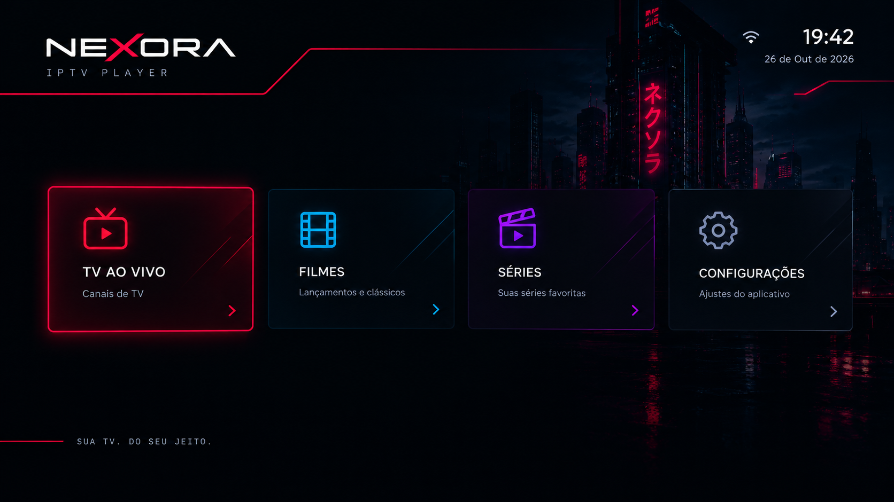

# AXION

**IPTV Player para Samsung Smart TV (Tizen)**
*Sua TV. Do seu jeito.*



O AXION é um reprodutor pensado para ser usado de longe e só com o controle remoto. A versão atual separa Filmes, TV ao vivo e Séries a partir de uma playlist M3U configurada pelo usuário.

> O AXION é apenas um **reprodutor**. Ele não fornece, hospeda nem indica conteúdo. Use somente listas e serviços que você tenha direito de usar.

## Status

🚧 **Em desenvolvimento.** O AXION usa a conexão direta para obter a playlist e pode usar um Cloudflare Worker opcional, sem intervenção na interface, quando necessário. O Worker ainda precisa ser publicado e configurado no arquivo local pelo responsável pela instalação. A classificação de conteúdo usa `group-title`, caminho do endereço e padrões comuns de nomes; compatibilidade de reprodução depende do provedor e do dispositivo.

## Visão geral

| | |
|---|---|
| Plataforma | Samsung Smart TV (Tizen) |
| Tipo de app | Aplicativo web (HTML5, CSS3, JavaScript) |
| Resolução base | 1920×1080 |
| Navegação | Controle remoto: direcionais, OK e Voltar |
| Seções | TV ao vivo, Filmes, Séries, Configurações |

Os requisitos de implementação e o roteiro de telas estão documentados neste README e nas mudanças do OpenSpec.

## Tecnologia

- Interface em HTML, CSS e JavaScript puros, sem frameworks
- O Worker remoto opcional é usado somente para obter playlists; o servidor Node local continua sendo apenas uma opção de prévia e desenvolvimento
- O usuário pode informar sua própria URL de playlist M3U em **Configurações**; o AXION não fornece listas nem mídia
- A reprodução usa AVPlay em uma TV Tizen compatível e `<video>` para visualização no navegador
- A playlist é classificada em Filmes, TV ao vivo e Séries por metadados/categorias e padrões no endereço; itens sem indicador específico são tratados como filmes
- Em Filmes e Séries, apenas **Todos**, **Favoritos** e **Continuar assistindo** são filtros fixos; as demais categorias vêm dos grupos presentes na playlist M3U
- Favoritos e progresso ficam no armazenamento local do dispositivo, sem conta ou sincronização
- Conteúdo e streams não são fornecidos pelo aplicativo

## Playlist do usuário

Abra **Configurações**, informe uma URL completa `http://` ou `https://` de uma playlist M3U sua e selecione **Carregar lista**. Em um servidor ainda não conhecido, o app tenta diretamente primeiro. Depois de carregar uma playlist com sucesso, guarda somente a preferência de rota por origem do servidor; nas próximas cargas começa pelo último caminho bem-sucedido e tenta a alternativa uma vez se necessário. Se ambos falharem, mostra uma mensagem simples.

O acesso de rede declarado em `config.xml` por `<access origin="*" subdomains="true"/>` não remove a política CORS do servidor da playlist. Essa declaração autoriza o widget a acessar origens de rede; o navegador ainda depende de o servidor remoto permitir leitura cross-origin por seus cabeçalhos CORS. Consulte o [portal oficial Samsung Smart TV](https://developer.samsung.com/smarttv/develop), a [especificação W3C de acesso de widgets](https://www.w3.org/TR/widgets-access/) e o [protocolo CORS do Fetch](https://fetch.spec.whatwg.org/#http-cors-protocol). Por isso, o Worker permanece como plano B para playlists que o app não consiga ler diretamente.

Para configurar esse plano B, copie `config.example.js` para `config.local.js` e preencha `workerUrl` e `workerToken` com os valores da sua implantação. O arquivo local é ignorado pelo Git; não o inclua em commits ou compartilhe o pacote se ele contiver um token. Sem o arquivo ou sem os dois valores, o app continua tentando carregar a playlist diretamente, sem mostrar erro de proxy. A configuração e o passo a passo de publicação estão em [`worker/README.md`](worker/README.md).

O Worker só aceita chamadas autenticadas de playlist para hosts explicitamente autorizados. O endereço da playlist viaja em um cabeçalho da requisição, não na URL do Worker; o código não deve registrar nem refletir esse endereço ou o token. O token incorporado num app cliente pode ser extraído do pacote; trate o Worker como serviço pessoal, restrinja os hosts e configure limite de requisições. O Worker não busca vídeo, segmentos ou chaves.

No plano Workers Free, a documentação da Cloudflare consultada em 31/10/2026 informa 100.000 requisições por dia por conta, 10 ms de CPU por invocação e 50 subrequests por invocação. Cada chamada recebida pelo Worker, inclusive uma preflight CORS, consome requisição; cada fetch/redirecionamento para a playlist consome subrequest. Isso não representa bytes nem streaming ilimitado. O binding de rate limit configurado é aproximado por IP e localidade Cloudflare, não uma barreira global rígida. Consulte os [limites oficiais](https://developers.cloudflare.com/workers/platform/limits/) e [instruções do Worker](worker/README.md) antes de publicar.

O player usa a URL original do item diretamente no AVPlay ou em `<video>` no navegador. Falhas de vídeo não acionam o Worker.

O endereço da playlist e a biblioteca ficam no armazenamento local do dispositivo. A URL é ocultada na tela por padrão, mas pode ser revelada temporariamente pelas Configurações. Não há conta nem sincronização na nuvem. Esse armazenamento não é criptografado pelo app; evite URLs com credenciais em dispositivos compartilhados.

## Player e validação

Filmes e episódios da playlist podem ser iniciados pelo botão **Assistir** em suas telas. Em Séries, os episódios aparecem nos detalhes, agrupados por série. A TV ao vivo tem uma categoria **Favoritos** para salvar e filtrar canais. A tela do player tem controles de reproduzir/pausar, avanço e retorno de dez segundos e fechamento pelo botão **Voltar** ou pela tecla Voltar do controle. No computador, o app usa `<video>`; em um app Tizen compatível, seleciona AVPlay.

Use os filtros **Favoritos** e **Continuar assistindo** no catálogo. O AXION salva a posição durante a reprodução e ao pausar ou sair, permite retomar títulos disponíveis e remove o progresso quando a reprodução chega a 90%. Registros de títulos ausentes da playlist ficam guardados localmente, mas não são exibidos como ações disponíveis.

Para validar localmente, execute `node tests/worker.mjs` e `node tests/server-proxy.js`. As fixtures HTML em `tests/` validam os fluxos do app e usam endereços fictícios; o teste do Worker simula respostas e não acessa nem publica serviços externos. O teste de reprodução usa um pequeno vídeo sintético local em `tests/fixtures/`.

Para instalar na TV, abra o projeto no Tizen Studio com a extensão Samsung TV, crie/registre um certificado de desenvolvedor e execute o app em uma TV compatível. O `config.xml` declara as permissões de internet e AVPlay. A integração remota e os adaptadores foram testados localmente, mas o Worker ainda não foi publicado e o hardware Tizen, certificado, CORS real e codecs não foram validados neste ambiente.

## Visualizar no navegador

Com Node.js instalado, abra um terminal na pasta do projeto e inicie o servidor local:

```powershell
node server.js
```

Abra `http://localhost:8000` no navegador do computador. Para acessar pela TV,
inicie o servidor permitindo conexões na rede local:

```powershell
node server.js --host 0.0.0.0
```

Na TV, abra `http://IP-LOCAL-DO-COMPUTADOR:8000` (os dois dispositivos precisam
estar na mesma rede). Se o Windows solicitar, permita o acesso na rede privada.
Não encaminhe a porta do servidor pelo roteador nem o exponha em uma rede pública.

## Como o projeto é desenvolvido

O projeto usa o **OpenSpec** com o **GitHub Copilot**. Toda mudança segue o mesmo ciclo, e o Copilot o executa de forma automática (veja [`.github/copilot-instructions.md`](.github/copilot-instructions.md)):

1. **Explorar:** entender o problema e o código existente.
2. **Propor:** gerar `proposal.md`, `specs/`, `design.md` e `tasks.md` em `openspec/changes/`.
3. **Aplicar:** implementar as tarefas.
4. **Verificar:** conferir se a implementação bate com a especificação.
5. **Arquivar:** mover a mudança concluída para o histórico e atualizar `openspec/specs/`.

Para pedir algo novo, descreva a ideia no chat do Copilot (modo Agente). Os comandos do OpenSpec ficam em `.github/prompts/` e as skills em `.github/skills/`.

## Estrutura do repositório

```
nexora/
├── README.md
├── index.html                      # página de entrada
├── config.example.js               # exemplo sem credenciais para configurar o Worker
├── config.local.js                 # configuração local ignorada pelo Git
├── config.xml                      # manifesto do app Samsung Tizen e permissões AVPlay/rede
├── server.js                       # servidor local de prévia e proxy de playlists
├── worker/
│   ├── README.md                   # configuração e publicação manual do Worker de playlists
│   ├── wrangler.toml               # implantação e limite de requisições
│   └── src/index.mjs               # fallback autenticado para playlists M3U
├── styles/
│   ├── app.css                     # estilos globais e foco
│   ├── live-tv.css                 # identidade visual da TV ao vivo
│   ├── movies.css                  # catálogo, pesquisa e biblioteca de filmes
│   ├── series.css                  # detalhes e seleção de episódios no catálogo
│   ├── player.css                  # tela do player
│   └── settings.css                # configuração da fonte M3U
├── scripts/
│   ├── app.js                      # estrutura e navegação entre telas
│   ├── focus-navigation.js         # controle de foco
│   ├── home.js                     # relógio e entrada da tela inicial
│   ├── live-tv.js                  # tela e categorias de canais da playlist
│   ├── series.js                   # agrupamento, pesquisa e seleção de episódios
│   ├── movies.js                   # catálogo, pesquisa, favoritos e retomada
│   ├── media-library.js            # configurações, favoritos e progresso locais
│   ├── media-source.js             # carregamento M3U direto com fallback remoto opcional
│   ├── player-adapter.js           # adaptadores AVPlay e vídeo do navegador
│   ├── player-screen.js            # tela e controles do player
│   └── settings.js                 # tela de configuração da playlist
├── assets/
│   └── cyber-city.svg              # cenário vetorial da tela inicial
├── tests/
│   ├── focus-navigation.html       # fixture de validação do foco
│   ├── live-tv.html                # fixture de categorias, guia e prévia
│   ├── movies.html                 # fixture do catálogo e detalhes de filmes
│   ├── settings.html               # fixture de URL e armazenamento local
│   ├── media-source.html           # fixture M3U com XHR simulado
│   ├── server-proxy.js             # testes locais do servidor/proxy
│   ├── series.html                 # agrupamento e ordenação de episódios fictícios
│   ├── player-adapter.html         # fixture dos adaptadores com mídia simulada
│   ├── player.html                 # teste local da tela e dos controles do player
│   ├── favorites.html              # persistência e disponibilidade dos favoritos
│   ├── progress.html               # progresso, retomada e limite de 90%
│   ├── library-flow.html           # fluxo remoto com playlist e player simulados
│   └── fixtures/
│       └── axion-player-test.mp4   # vídeo sintético local para teste no navegador
├── tela-inicial.png                # referência visual da tela inicial
├── openspec/
│   ├── config.yaml                 # configuração e contexto do OpenSpec
│   ├── specs/                      # especificações vigentes
│   └── changes/                    # mudanças em andamento e arquivadas
└── .github/
    ├── copilot-instructions.md     # regras permanentes para o Copilot
    ├── prompts/                    # comandos do OpenSpec
    └── skills/                     # skills do OpenSpec
```

## Primeiros passos para desenvolver

1. Abra a pasta do projeto no VS Code e reinicie o editor.
2. No chat do Copilot, use o **modo Agente**.
3. Use o servidor local descrito acima para visualizar a tela inicial, abrir **TV ao vivo** ou **Filmes** e testar a navegação por teclado.
4. A referência visual da tela inicial está em `tela-inicial.png`.

## Roteiro

- [x] Estrutura base, tela inicial e navegação por controle remoto
- [x] Configurações (URL da playlist M3U)
- [x] Leitura de lista M3U
- [x] TV ao vivo (interface demonstrativa com canais fictícios; sem reprodução)
- [x] Player (AVPlay na TV e `<video>` no navegador)
- [x] Filmes (pesquisa, Favoritos, Continuar assistindo e retomada)
- [ ] Séries

## Licença

A definir.
